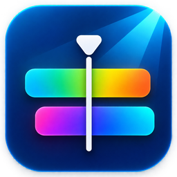
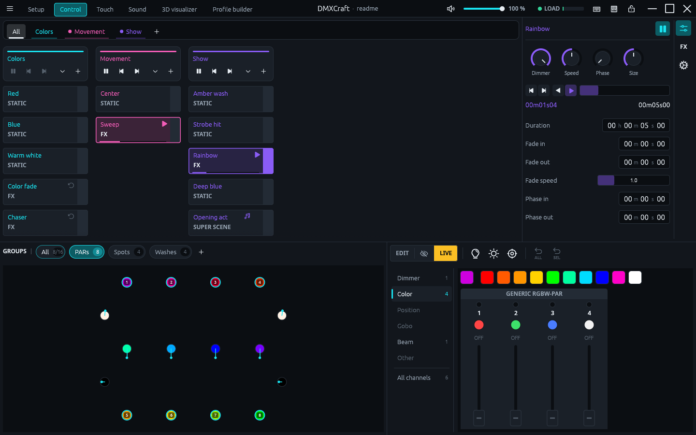
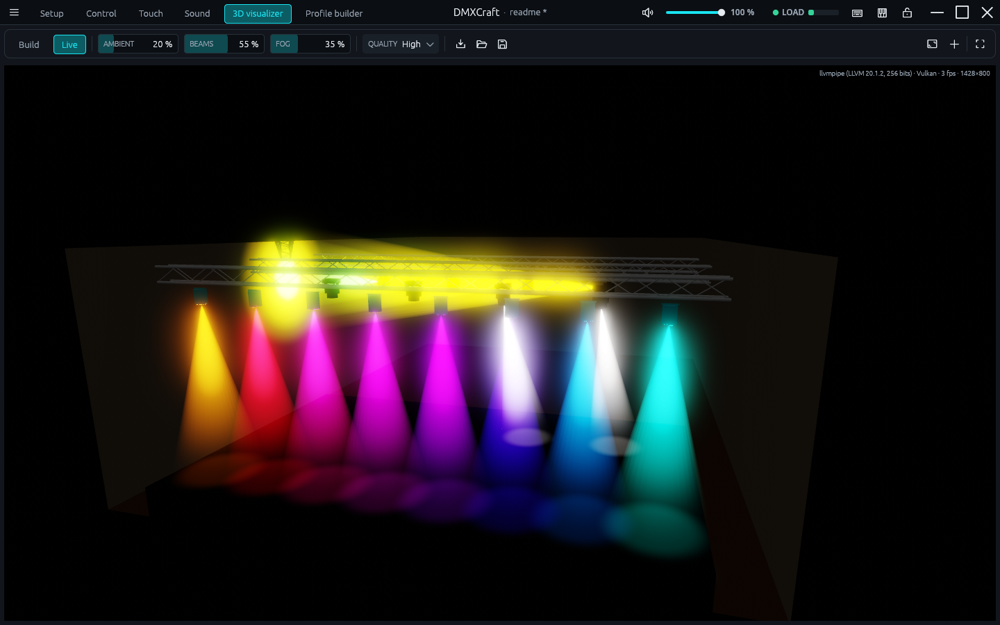
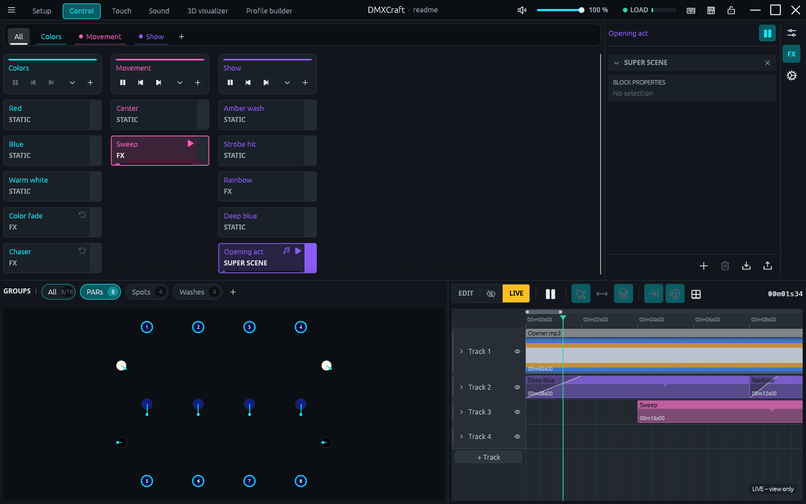
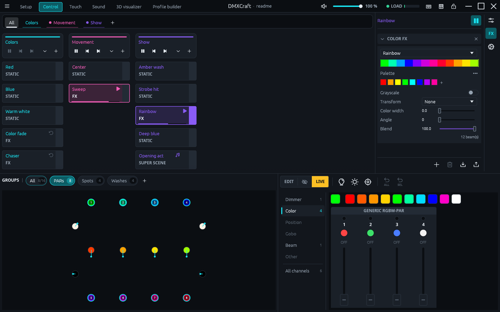
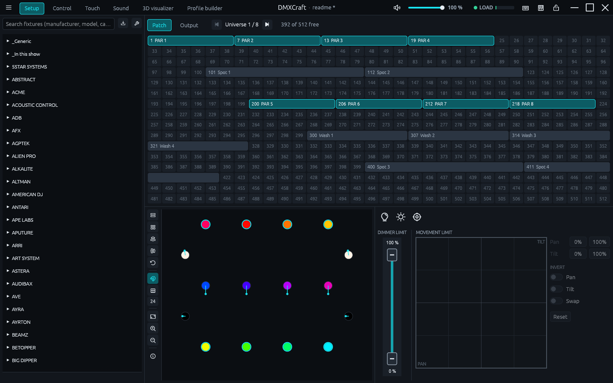
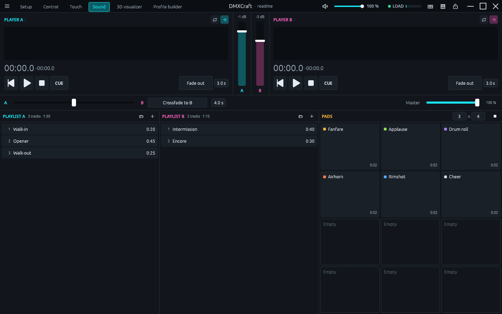
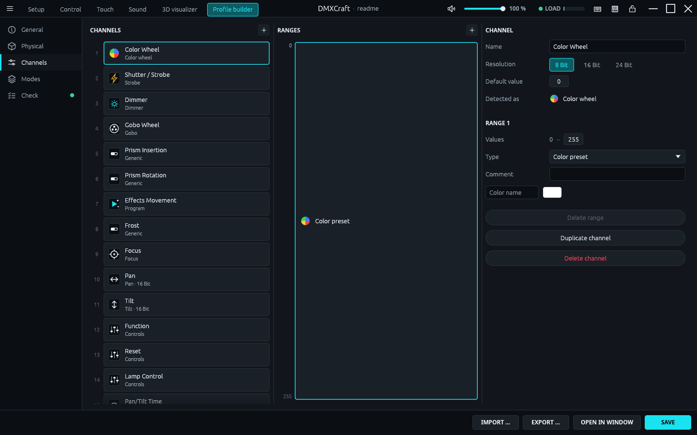

<div align="center">

<h1>&nbsp;DMXCraft</h1>

**DMX lighting control for Linux, Windows and macOS, written in Rust.**

Banks of scenes, a programmer, effects, SUPER SCENES on a timeline with music,
a sound player and a live 3D visualizer. Output goes through inexpensive USB-DMX cables.

[](https://github.com/JustinSchweiger/DMXCraft/actions/workflows/ci.yml)
[](https://github.com/JustinSchweiger/DMXCraft/releases/latest)
[](https://github.com/JustinSchweiger/DMXCraft/releases)
[](LICENSE)


[Download](https://github.com/JustinSchweiger/DMXCraft/releases/latest) ·
[Features](#features) ·
[Install](#install) ·
[Docs](#documentation) ·
[Build](#build-from-source)



</div>

> [!NOTE]
> The workflow is largely inspired by Daslight 5. DMXCraft is an independent project and not
> affiliated with Nicolaudie/Daslight. No code, fixture library or graphics from Daslight are used.

## Features

|  |  |
|---|---|
| 🎯 **Live tracking** | Moving heads follow points in the room – any number of targets, each with its own heads, dragged on a room plan or moved with MIDI faders; release fades back to the scenes |
| 🎛️ **Scenes & banks** | Static scenes, step sequences, fades, zones and a programmer with live/edit mode |
| 🌈 **Effects** | Color, movement and curve effects across any fixture group, with presets and palettes |
| 🎬 **SUPER SCENES** | Timeline with light and media tracks, beat grid from audio analysis, audio triggers, pre-positioning of moving heads before a block (move in black), scene groups as reusable blocks, blocks that blend over the tracks below (a fading flash returns to the color below) or cover them |
| 🔊 **Sound player** | Two decks with playlists, crossfade and a configurable grid of jingle pads |
| 🧊 **3D visualizer** | Build your venue with trusses and objects, see beams, fog and gobos live |
| 🧩 **Fixture library** | 2,400+ fixtures from the Open Fixture Library and QLC+, plus your own in the Profile Builder |
| 🎹 **Control** | Keyboard, MIDI and a freely designed touch surface |
| 📺 **OBS** | Play videos from SUPER SCENES in an OBS browser source in sync with sound and light, and switch OBS scenes |
| 🤖 **AI assistant** | Built-in MCP server: let an AI assistant patch fixtures and program scenes |
| 🔌 **Output** | Up to 8 universes over USB-DMX (Open DMX / FTDI), one cable per universe, or simulation |
| 💾 **Safe** | Auto-save and recovery of unsaved changes after a crash |
| 🌍 **Everywhere** | English and German UI, installers and auto-update for all three systems |

## Screenshots

<table>
  <tr>
    <td width="50%"><br><sub><b>3D visualizer</b>: beams, fog and moving heads in your venue</sub></td>
    <td width="50%"><br><sub><b>SUPER SCENES</b>: scenes and music on one timeline</sub></td>
  </tr>
  <tr>
    <td><br><sub><b>Effects</b>: a rainbow color effect across all PARs and washes</sub></td>
    <td><br><sub><b>Setup</b>: patch, fixture library and stage plan</sub></td>
  </tr>
  <tr>
    <td><br><sub><b>Sound</b>: two decks, playlists and jingle pads</sub></td>
    <td><br><sub><b>Profile Builder</b>: create or adapt fixture profiles</sub></td>
  </tr>
</table>

## Install

Grab the latest version from the **[releases page](https://github.com/JustinSchweiger/DMXCraft/releases/latest)**.
Builds exist for Linux (x86_64, ARM64), macOS (Apple Silicon and Intel) and Windows (x86_64).
DMXCraft checks for updates on startup and offers them in the title bar.

<details open>
<summary><b>Windows</b></summary>

Download and run `dmxcraft-x86_64-pc-windows-msvc.msi`, or use PowerShell:

```powershell
powershell -ExecutionPolicy Bypass -c "irm https://github.com/JustinSchweiger/DMXCraft/releases/latest/download/dmxcraft-installer.ps1 | iex"
```
</details>

<details open>
<summary><b>macOS</b></summary>

Download `DMXCraft-macos-universal.dmg`, open it and drag DMXCraft into *Applications*.

The app is not notarized by Apple. On first launch go to *System Settings → Privacy & Security →
Open Anyway*, or run:

```sh
xattr -dr com.apple.quarantine /Applications/DMXCraft.app
```
</details>

<details open>
<summary><b>Linux</b></summary>

```sh
curl --proto '=https' --tlsv1.2 -LsSf https://github.com/JustinSchweiger/DMXCraft/releases/latest/download/dmxcraft-installer.sh | sh
```

The same command works on macOS if you prefer a terminal install without an app bundle.
</details>

### USB-DMX cables

Plug in the cable and assign it to a universe under *Edit → Settings … → Outputs*. Without an
assignment DMXCraft runs in simulation mode. On Linux your user needs access to `/dev/ttyUSB*`:

```sh
sudo usermod -aG dialout $USER   # then log out and back in
```

## Documentation

| Guide | Topic |
|---|---|
| [MAPPING.md](docs/MAPPING.md) | Keyboard and MIDI mapping |
| [TOUCH.md](docs/TOUCH.md) | Designing touch surfaces |
| [VISUALIZER.md](docs/VISUALIZER.md) | 3D visualizer and venue builder |
| [SOUND.md](docs/SOUND.md) | Sound player and pads |
| [OBS.md](docs/OBS.md) | OBS integration |
| [MCP.md](docs/MCP.md) | Connecting an AI assistant over MCP |

## Build from source

Requires Rust 1.89 or newer.

```sh
cargo run --release -p dmxcraft                  # starts with a demo show
cargo run --release -p dmxcraft -- show.dmxcraft # opens a show file
cargo test --workspace
```

On Windows, `.\scripts\dev.ps1` does the same after a `git pull` and first stops any DMXCraft
process still running from the build folder (a running `.exe` cannot be overwritten).

<details>
<summary><b>Project layout</b></summary>

```
crates/
  core/    data model, engine, effects, timeline, audio analysis (no I/O)
  output/  output thread and backends (simulation, USB-DMX cable)
  ofl/     fixture library (Open Fixture Library, QLC+)
  mcp/     MCP server
  app/     user interface (egui), 3D visualizer, updater
docs/      guidelines and guides
```
</details>

<details>
<summary><b>Releasing</b></summary>

On Windows, run the release script with the new version:

```powershell
.\scripts\release.ps1 0.4.2
```

It checks that you are on a clean, up-to-date `main`, bumps the version in `Cargo.toml`, runs
the tests, then commits, tags `v0.4.2` and pushes both. Elsewhere, do the same by hand: bump
`[workspace.package] version`, commit, then `git tag vX.Y.Z && git push origin main vX.Y.Z`.

GitHub Actions builds all platforms, the installers and the macOS DMG, and puts install
instructions (`.github/release-install.md`) at the top of the release notes.
</details>

<details>
<summary><b>Updating the fixture library</b></summary>

```sh
git clone --depth 1 https://github.com/OpenLightingProject/open-fixture-library /tmp/ofl
cargo run --release -p dmxcraft-ofl --bin ofl-bundle -- /tmp/ofl crates/ofl/data/ofl-library.json.gz

git clone --depth 1 --filter=blob:none --sparse https://github.com/mcallegari/qlcplus /tmp/qlcplus
(cd /tmp/qlcplus && git sparse-checkout set resources/fixtures)
cargo run --release -p dmxcraft-ofl --bin qlc-bundle -- /tmp/qlcplus crates/ofl/data/qlc-library.json.gz
```
</details>

## License

DMXCraft is licensed under the **GNU General Public License v3** with an additional term under
section 7(b): distributed and modified versions must show “Based on DMXCraft by Justin Schweiger”
in their About dialog. See [LICENSE](LICENSE) for details. Earlier versions released under MIT
remain under MIT.

For use outside these terms (for example in closed-source software) a separate license is
available. Ask via GitHub.

Bundled fixture data comes with its own licenses: QLC+ under Apache-2.0
(`crates/ofl/data/QLC-LICENSE`, `QLC-NOTICE`) and the Open Fixture Library under MIT
(`crates/ofl/data/OFL-LICENSE`).

“Daslight” is a trademark of its owner and is mentioned here only for description.
